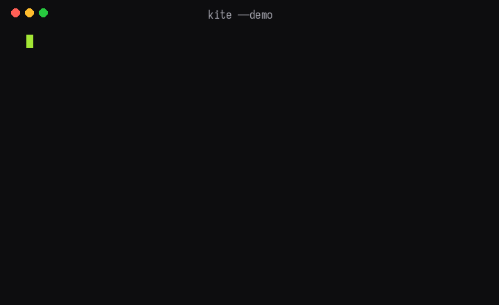

# Kite

A fast, minimal static site generator written in Go. Transform Markdown files into beautiful, themed websites with zero dependencies at runtime.

<p>
  
  
</p>



## Website

Docs and landing page live at **https://kite.himanshu.co** — source in [`website/`](website/) (built with kite itself).

## Installation

```bash
go install github.com/HimanshuSardana/kite@latest
```

## Updating

```bash
kite update         # download and install the latest release binary
kite update --check # just check whether an update is available
kite -v             # show the installed version
```

Releases are cut from `v*` git tags — pushing a tag builds version-stamped
binaries for Linux, macOS and Windows and publishes them on GitHub, which is
what `kite update` downloads (and checksum-verifies).

## Usage

### Initialize a New Blog

```bash
kite init
```

This interactive command walks you through:
- Blog name and site title
- Author information
- Theme selection
- Creates `content/`, `output/`, `themes/` directories
- Generates config and a sample post

### Build Your Site

```bash
kite build
```

Or specify a theme:

```bash
kite build gruvbox
```

### Preview Locally

```bash
kite serve
```

Visit `http://localhost:8000` to see your site.

### Static Files

Anything in `static/` is copied as-is to `output/` on every build
(favicons, images, `robots.txt`, extra CSS). `kite serve` watches it too.

### Drafts

`draft: true` in frontmatter hides a post from normal builds.
`kite build --drafts` / `kite serve --drafts` includes it for preview.

### Feeds & Sitemap

Every build regenerates `feed.xml` and `sitemap.xml`, and adds an RSS
autodiscovery `<link>` to each page — no theme changes needed.

### Open Graph Images

Every post can ship a social card rendered from Typst. Create `og.typ` in the
project root (or point `ogTemplate:` at another file in `config.yaml`) and each
build writes `output/<slug>/og.png` next to the post, plus `og:image` and
`twitter:image` tags in the page head:

```
kite build
# Generated 5 OG image(s)
# OG meta tags added to 5 pages
```

Cards are opt-in: if the template or the `typst` binary is missing, the build
warns and skips them instead of failing. `kite serve` watches the template too.

The template receives these `--input` values, readable with
`sys.inputs.at(...)`:

| key | example |
|-----|---------|
| `title` | `Writing a static site generator` |
| `date` | `Mar 24, 2026` (stable — relative dates would bake in) |
| `author` | `authorName` from config |
| `site` | `siteTitle` from config |
| `slug` | `writing-a-static-site-generator` |
| `url` | `https://example.com/writing-a-static-site-generator/` |
| `tags` | `go, static-sites` |

Images render at `--ppi 72`, so set the page to the canonical card size for an
exact 1200×630 PNG (the build reads the real size from the file for the meta
tags):

```typst
#set page(width: 1200pt, height: 630pt, margin: 48pt, fill: rgb("#1c1c1e"))
#set text(fill: rgb("#f5f5f7"))

#let title = sys.inputs.at("title", default: "Untitled")
#let site = sys.inputs.at("site", default: "")
#let author = sys.inputs.at("author", default: "")

#align(center + horizon)[
  #text(size: 48pt, weight: "bold")[#title]
  #v(16pt)
  #text(size: 20pt)[#site — #author]
]
```

## Commands

| Command | Description |
|---------|-------------|
| `kite init` | Initialize a new blog project |
| `kite new hello.md` | Create a post with stamped frontmatter (`--draft` starts it as a draft) |
| `kite build` | Build the static site |
| `kite build <theme>` | Build with a specific theme |
| `kite serve` | Start local development server |
| `kite serve --port 8080` | Serve on custom port |
| `kite list-themes` | Show available themes |
| `kite check` | Check `output/` for broken internal links (exit 1 if any) |
| `kite version` / `kite -v` | Show the installed version |
| `kite update` | Self-update to the latest GitHub release (`--check` to dry-run, `--force` to reinstall) |

## Configuration

Edit `config.yaml` to customize your site:

```yaml
siteTitle: "Your Blog Name"
authorName: "Your Name"
authorRole: "Writer & Developer"
authorBio: "A short bio about yourself"
defaultTheme: "modern-light"
siteUrl: "https://your-domain.com"
ogTemplate: "og.typ"   # Typst source for social cards (default)
```

## Themes

Kite comes with 13 built-in themes:
- modern-light
- modern-dark
- modern-dark-2
- modern-dark-catppuccin
- everforest
- gruvbox
- rose-pine
- terminal-gruvbox
- tufte
- magical
- notes — margin/floating table of contents, four-per-row home grid and LaTeX math + TikZ/Mermaid diagrams
- minimal-notes — same post pages as notes, slrncl-style dateline index home page
- flectar — dark SaaS-landing style home (hero, featured-post window, archive strip, cards) with matching serif post pages

